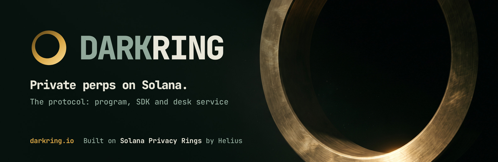
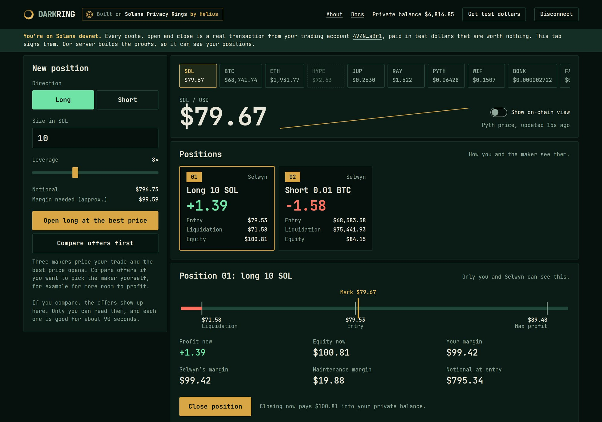
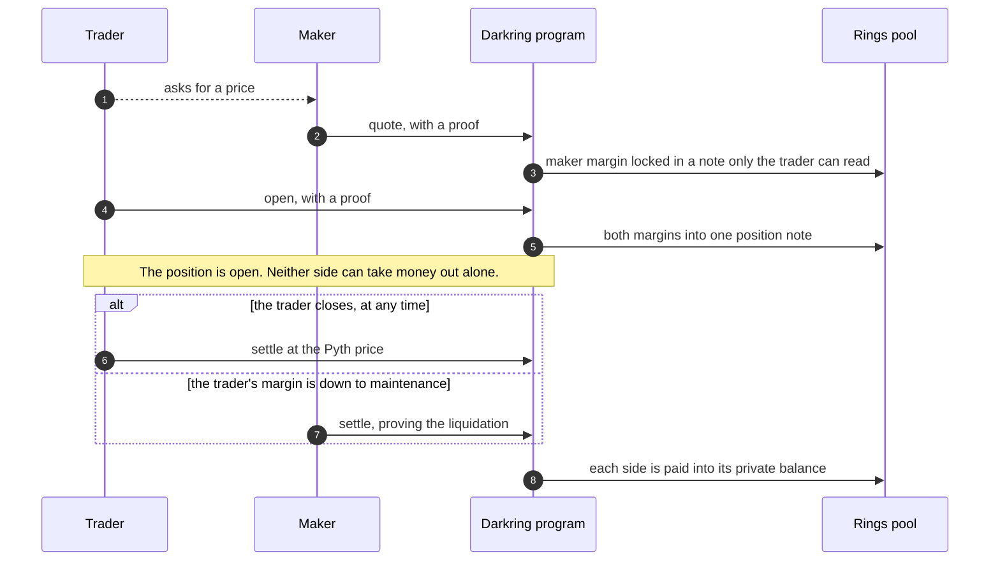

<p align="center">
  <a href="https://darkring.io"></a>
</p>

<p align="center">
  Trade perps on Solana without anyone seeing your size, direction, entry or liquidation price.<br>
  On-chain it is two addresses and a proof.
</p>

<p align="center">
  <a href="https://app.darkring.io"></a>
  <a href="https://darkring.io"></a>
  <a href="https://darkring.io/docs"></a>
  <a href="https://x.com/darkringio"></a>
  <a href="https://github.com/darkringio"></a>
</p>

<p align="center">
  
  
  
  
</p>

# Darkring

Darkring is a perpetuals protocol where the position itself is private. You go long or short with leverage, like on any perps venue, and nobody watching the chain can tell what you hold. It is built on [Solana Privacy Rings](https://github.com/helius-labs/zolana), the shielded pool by Helius.

This repository is the protocol: the on-chain program, the SDK, the desk service and the tests. The website and the trading app are a separate codebase; you can use them at [app.darkring.io](https://app.darkring.io).

> [!WARNING]
> **Devnet only. Not audited.** The circuits use insecure test keys made from a fixed public seed, so anyone can forge the proofs, and the program builds only with the `insecure-test-setup` feature. Do not use it with real funds. A mainnet deployment needs its own trusted setup, verifying keys, program ID and audit.

## Contents

- [What the chain sees](#what-the-chain-sees)
- [How a position works](#how-a-position-works)
- [What is in this repository](#what-is-in-this-repository)
- [Live on devnet](#live-on-devnet)
- [Build and test](#build-and-test)
- [Run the desk](#run-the-desk)
- [Not built yet](#not-built-yet)
- [Links](#links)

## What the chain sees

| Public | Hidden |
| --- | --- |
| Both addresses | Size |
| When a quote is posted | Long or short |
| When a position opens | Entry price |
| Which token is the collateral | Both margins |
| At close: the market and the oracle price | Leverage |
| | Liquidation price |
| | PnL and payouts |

The public side is enough for anyone to check that every position is fully funded and every payout is right. Two things to know:

- The maker on the other side can see your position. It is their money against yours.
- Moving money in or out of a private balance is public, like any token transfer. What happens while it is inside is what is hidden.

<p align="center">
  <a href="https://app.darkring.io"></a>
  <br>
  <sub>The desk on devnet. Only the trader and the maker can read what is on this screen.</sub>
</p>

## How a position works

There is no order book and no shared pool. Every position is a deal between a trader and one maker, who puts up the money that pays the trader if they are right.



1. **Quote.** A maker locks its margin in a shielded note addressed to the trader, with the entry price and terms inside.
2. **Open.** The trader accepts. Both margins move into one position note that neither side can spend alone.
3. **Settle.** Either side closes at the Pyth price, and the program pays both private balances in the same transaction. The trader can close whenever they like. The maker can close only once the trader's margin has fallen to the maintenance level, and proves that without revealing where the liquidation price is.
4. **Cancel.** A quote nobody took goes back to its maker after it expires.

| | |
| --- | --- |
| Most you can lose | Your margin |
| Most you can win | The maker's margin |
| Liquidation | When your margin minus your loss equals the maintenance margin set in the quote |
| Fees | No trading fee and no funding rate in this build. Makers earn the spread. |

The [docs](https://darkring.io/docs) explain all of this for traders, with a worked example.

## What is in this repository

| Path | What it is |
| --- | --- |
| [`program/`](program) | The Solana program and its four circuits: quote, open, settle and cancel quote. It verifies its own proof and hands the shielded transfer to the Rings pool. It stores no state. |
| [`sdk/`](sdk) | Rust SDK. Builds and proves each transaction, and finds a trader's quotes and a maker's positions. |
| [`service/`](service) | The devnet desk: three makers quoting eleven markets, and the HTTP API behind app.darkring.io. A trader's keys stay in the trader's browser, which proves its own trades; the service assembles and sends them. |
| [`test/`](test) | End-to-end tests: `tests/perps.rs` against a local validator, `tests/devnet.rs` against devnet. |
| [`scripts/`](scripts) | Tool setup, the devnet deploy, devnet wallets, the desk launcher and the browser package build. Each script's header says what it needs. |
| [`deploy/`](deploy) | The systemd unit for the desk service. |
| [`docs/reference/`](docs/reference) | The design of the Rings swap example this program grew out of. |

## Live on devnet

| | Address |
| --- | --- |
| Darkring program | [`HY5QBm2yMqKDRnYSU11qi5ZeD3m2hL4WUUT2WLTzvWNF`](https://solscan.io/account/HY5QBm2yMqKDRnYSU11qi5ZeD3m2hL4WUUT2WLTzvWNF?cluster=devnet) |
| Test dollar mint | [`3vAru2sJGnNQAbYLQK8eAJGkPsDirj3uMKR6s2qzjG8r`](https://solscan.io/token/3vAru2sJGnNQAbYLQK8eAJGkPsDirj3uMKR6s2qzjG8r?cluster=devnet) |
| Rings shielded pool | [`ring1GaLCuJnkUMVkX2JeZLTTX17wKsV4fZmPVzXANW`](https://solscan.io/account/ring1GaLCuJnkUMVkX2JeZLTTX17wKsV4fZmPVzXANW?cluster=devnet) |

**Markets.** SOL, BTC, ETH, HYPE, JUP, RAY, PYTH, WIF, BONK, FARTCOIN and PUMP, each against the dollar. A market needs nothing deployed, only a Pyth price feed, so the list is a table in [`service/src/chain.rs`](service/src/chain.rs).

**Prices.** Pyth. The devnet build accepts a price up to 10 minutes old, because devnet price accounts refresh slowly; the default build accepts 60 seconds. The desk pauses a market while its price is too old to settle at.

## Build and test

The Zolana SDK is pinned to a Git revision in [`Cargo.toml`](Cargo.toml). Two scripts fetch the matching CLI and local tools, and print the variables to export:

```sh
scripts/setup-zk-tools.sh      # the Zolana CLI that matches the pinned SDK
scripts/build-localnet.sh      # prover, indexer, local validator and pool program
```

With those set, run a position's whole life against a local validator:

```sh
cargo test --release -p perps-test --test perps
```

The devnet run spends devnet SOL and is ignored by default. It needs a devnet RPC, a Rings indexer URL and the wallets `scripts/devnet-setup.sh` makes. The header of [`test/tests/devnet.rs`](test/tests/devnet.rs) lists them.

```sh
cargo test --release -p perps-test --test devnet -- --ignored --nocapture
```

## Run the desk

```sh
scripts/run-desk.sh
```

This starts the desk service on `127.0.0.1:5374`. It needs a `.env` with `HELIUS_API_KEY` and the devnet wallets in `keys/`. Neither is in this repository.

A trader's wallet signs one message, and the browser derives a separate trading account from that signature. Every key of that account stays in the browser. The browser reads its own balance, and builds and proves each open and close itself:

- **The program's proof** is made in the browser, with the program's own Rust compiled to WebAssembly. `scripts/build-web-package.sh` builds that package from the compiled circuits.
- **The Rings pool's proof** has no browser prover yet, so it is made by Helius's prover, which runs in an enclave. The browser attests the enclave and encrypts the request to it. The service relays the ciphertext and cannot read it.

The service is handed the two finished proofs, puts them in the program's instruction, sends the transaction back to the browser to sign, and sends it to Solana. It cannot see a trader's balance and cannot move its funds. It does know every position opened on this desk, because the three makers are its own, and a maker always knows the position it takes the other side of.

## Not built yet

- **Both proofs in the browser.** The program's proof is made in the trader's browser. The Rings pool's proof is made in Helius's enclave, which the trader has to trust with the notes that trade spends and creates.
- **Deposits and withdrawals of your own tokens.** Accounts are funded with test dollars from a faucet.
- **Open makers.** The three makers are ours. Who provides liquidity on mainnet is an open question.
- **Funding.** There is no funding rate. Only the makers' pricing keeps quotes near spot.
- **A trusted setup and an audit.** See the warning at the top.

## Links

| | |
| --- | --- |
| Trading app | https://app.darkring.io |
| Website | https://darkring.io |
| Docs | https://darkring.io/docs |
| Risks | https://darkring.io/risks |
| X | [@darkringio](https://x.com/darkringio) |
| GitHub | [darkringio](https://github.com/darkringio) |

Built on [Solana Privacy Rings](https://github.com/helius-labs/zolana) by Helius, with prices from [Pyth](https://pyth.network). Darkring is an independent project and is not affiliated with or endorsed by Helius, the Solana Foundation or Pyth.

## License

[Apache License 2.0](LICENSE). Parts of this repository began as the confidential swap example of Solana Privacy Rings, which carries the same license; see [NOTICE](NOTICE).
